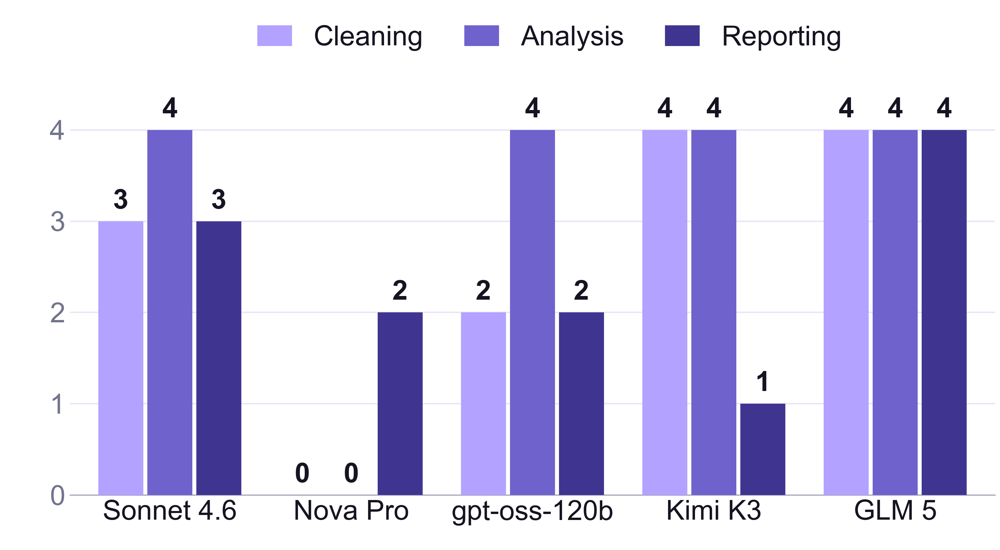
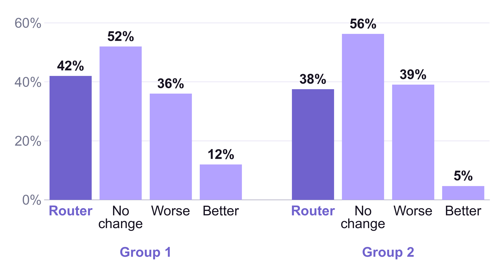

# Which LLM Should I Use for My Task?

An empirical study of model choice in multi-step AI workflows. Real AWS Bedrock runs, sandboxed code execution,
fixed automatic checks, and cost counted as part of the evaluation.

**中文简介：** 我们都有自己常用的 AI 模型，但选哪个、怎么搭配往往凭经验。这个项目用真实运行结果回答三个问题：Q1 各模型擅长哪一步；Q2 多模型接力是否优于单模型；Q3 路由器的解释和预测是否可信。成本也作为评价的一部分。详细中文结果见 [docs/RESULTS_REPORT.md](docs/RESULTS_REPORT.md)。

## Research questions

| | Question |
|---|---|
| **Q1** | Which model is good at which step (clean, analyze, report)? |
| **Q2** | Does mixing models across steps beat using one model throughout? |
| **Q3** | Can a model router's explanations and predictions be trusted? |
| **Cost** | Which workflow is worth its cost, not just which one succeeds? |

## How it was tested

- **4 synthetic data-science projects** (customer churn, energy consumption, retail sales, support operations), each a
  3-step workflow: **Clean → Analyze → Report**. Synthetic data gives every step a known correct answer.
- **Two model groups of 3 Bedrock models each.** Every model ran every step alone and in every combination
  (3 × 3 × 3 = 27 workflows per project):
  - Group 1: Claude Sonnet 4.6, Amazon Nova Pro, gpt-oss-120b
  - Group 2 (price-matched): Claude Sonnet 4.6, Kimi K3, GLM 5
- **Success** means the final output passes fixed automatic checks. Total spend is recorded for every run,
  including failed ones.
- **A router** recommends model swaps and explains its choices. Its explanations are checked against its own
  computation, and its predictions are checked against real outcomes.

## Findings

### Q1: no model wins every step



Strengths depend on the step. Kimi K3 passed cleaning on all 4 projects but reporting on only 1. Nova Pro failed
cleaning and analysis on all 4 but passed 2 reports. Pick a model for the step, not by its overall reputation.

### Q2: mixing models is not reliably better


Group 2: single-model workflows 50% vs mixed 48%. Group 1: 17% vs 24%, both low. Errors in an early step carry into
later ones, so a workflow is only as strong as its weakest step and has to be tested as a whole.

### Q3: faithful explanations, no predictive skill



All 880 of 880 explanation sentences match the router's own computation. But its predictions of whether a swap helps
are right 42% (Group 1) and 38% (Group 2) of the time, while always guessing "no change" gets 52% and 56%.
A clear explanation is not the same as a correct prediction.

### Cost: same success, very different cost


| Group | Workflow (clean → analyze → report) | Avg cost per run | Projects passed |
|---|---|---|---|
| 1 | gpt-oss → gpt-oss → Nova | $0.010 | 3/4 |
| 1 | Sonnet → gpt-oss → Nova | $0.068 | 3/4 |
| 1 | Sonnet only | $0.145 | 2/4 |
| 2 | GLM only | $0.022 | 4/4 |
| 2 | GLM → Sonnet → GLM | $0.056 | 4/4 |
| 2 | Sonnet only | $0.144 | 1/4 |

Two workflows can reach the same success at very different prices, and the most expensive model is not the most
successful. Whether to switch models depends on cost as well as success.

## Limitations

- 4 synthetic projects, and most workflow paths were run once.
- Only models available on AWS Bedrock to this account were tested.
- The two groups used different output-token limits (4096 vs 16384), so they are not directly comparable.
- Success is judged by fixed automatic checks. Some results were re-labeled after the experiments under rules
  committed in advance. The original (frozen) results are never edited, and both views are reported side by side
  in [docs/FINAL_REPORT.md](docs/FINAL_REPORT.md). The charts above show the re-labeled values.

## Next steps

- Test more workflows, models, and real projects, with repeated runs.
- Retrain the router so it beats simple baselines.
- Build a tool that recommends workflows by success and cost.

## Repository guide

| What | Where |
|---|---|
| Full report: every number with its source, plus a verification guide | [docs/FINAL_REPORT.md](docs/FINAL_REPORT.md) |
| Results write-up in Chinese | [docs/RESULTS_REPORT.md](docs/RESULTS_REPORT.md) |
| Experiment protocol, amendments, and post-hoc rules | `docs/*PROTOCOL*.md`, `docs/*AMENDMENT*.md`, `docs/*RULES*.md` |
| Code: Bedrock client, workflow runner, routing | `src/` |
| Experiment runners and analyses | `experiments/` |
| Synthetic projects and ground truth | `datasets/` |
| Raw records, processed results, reports | `results/raw/`, `results/processed/`, `results/reports/` |
| Poster charts and the script that draws them | `poster/charts/` |
| Tests | `tests/` |
| Demo site (Next.js) | `web/` |
| Provenance of this public snapshot | [PROVENANCE.md](PROVENANCE.md) |

## Reproduce the analyses (offline, no model calls)

Requires Python 3.11+.

```bash
python -m venv .venv && .venv/bin/pip install -e .
.venv/bin/python -m pytest -q
.venv/bin/python -m experiments.verify_frozen_hashes
.venv/bin/python -m experiments.analyze_router_relabel
.venv/bin/python -m experiments.analyze_failure_taxonomy
python3 poster/charts/make_charts.py
```

New model runs need AWS Bedrock access. They are not needed to check any of the numbers above, which all come from
the saved records in `results/`.

## Author

Shelly Cao, M.S. Interdisciplinary Data Science, Duke University.
