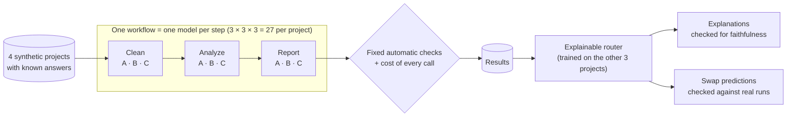
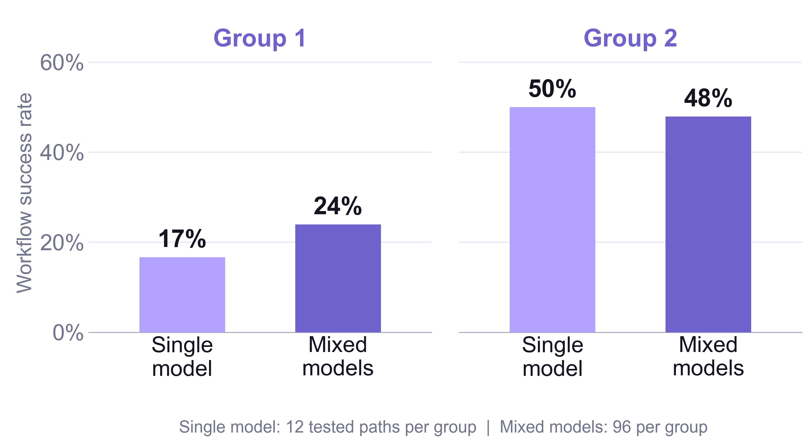
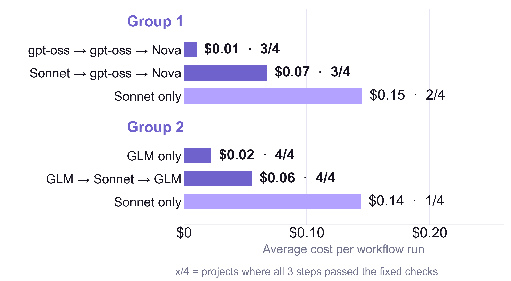

<div align="center">

# Which LLM Should I Use for My Task?

**Testing model choice, model mixing, and explainable model recommendations in multi-step AI workflows**

[](LICENSE)


[**Live demo**](https://modelflow-alpha.vercel.app) ·
[**Poster (PDF)**](poster/poster.pdf) ·
[**Full report**](docs/FINAL_REPORT.md) ·
[**Reproduce**](#reproduce-the-results)

Shelly Cao · M.S. Interdisciplinary Data Science · Duke University

</div>

---

## TL;DR

We all have favorite AI models, but are they the right ones for the job? I ran real models on AWS Bedrock through
every possible combination of a 3-step data-science workflow, and tested an explainable router that recommends which
model to use at each step.

| | Question | Answer |
|---|---|---|
| **Q1** | Which model is good at which step? | **It depends on the step.** No single model was best everywhere in Group 1. |
| **Q2** | Does mixing models beat using one? | **Not reliably.** 50% vs 48% in Group 2; errors carry forward through the workflow. |
| **Q3** | Can the router's explanations and predictions be trusted? | **Faithful, but not predictive.** 880/880 explanation sentences are faithful, yet predictions lose to "always guess no change". |
| **Cost** | Which workflow is worth it? | **Same success, very different cost.** Two workflows both pass 3/4 projects at $0.01 vs $0.07 per run. |

> **Key Responsible AI lesson:** an explanation can be completely faithful to how a system decided and still be
> wrong about the world. Faithful explanations alone can create false trust.

## Contents

[Why this matters](#why-this-matters) ·
[How it was tested](#how-it-was-tested) ·
[Findings](#findings) ·
[Design decisions](#design-decisions) ·
[Stakeholders and risks](#stakeholders-and-risks) ·
[Limitations and next steps](#limitations-and-next-steps) ·
[Reproduce the results](#reproduce-the-results) ·
[Repository guide](#repository-guide)

## Why this matters

People increasingly chain several AI models into one workflow, and tools now recommend which model to use for each
step, often with an explanation attached. This project treats those recommendations as a **Responsible AI evaluation
problem**:

- **Explainable AI (XAI):** an explanation can be *faithful* (it honestly describes how the system decided) and still
  be *wrong about the world*. This project measures both properties separately for the same router.
- **AI evaluation:** single-model benchmarks may not predict how models behave once chained together. Here every
  combination is actually run, and success is judged on the end-to-end output.
- **Human-AI interaction:** a fluent, faithful-sounding explanation can make people trust a recommendation more than
  its track record justifies.

<details>
<summary><b>Related work and contribution</b></summary>

- **Commercial routers** (OpenRouter, LiteLLM, Not Diamond, Amazon Bedrock Intelligent Prompt Routing, Azure Foundry
  model router, Martian, Unify) and open-source **RouteLLM** pick a model per request. Most report only *which*
  model was chosen; a few report *why*. None of the docs reviewed check the stated reasons or predictions against
  real outcomes. Workflow builders (Dify, n8n, CrewAI) leave model choice to the user.
- **Topaz** (Okamoto, Erol, Riedl, arXiv 2604.03527) routes subtasks of agentic workflows and explains choices from
  a trace, but its explanations are LLM-written and it does not evaluate faithfulness or validate against executed
  outcomes. **Routesplain** (arXiv 2511.09373) tests faithfulness with concept interventions for single-query routing,
  not against real downstream outcomes.
- **XAI faithfulness:** Jacovi & Goldberg (2020) separate faithfulness (does the explanation reflect the model's
  reasoning?) from plausibility. Karimi et al. (2020) distinguish counterfactual explanations from real
  interventions. This project applies that distinction to LLM routing.
- **Over-reliance on explanations:** Bansal et al. (CHI 2021) found that AI explanations can increase acceptance of
  AI recommendations whether or not they are correct.

**Contribution:** to our knowledge, this is the first evaluation that measures *both* the faithfulness and the
empirical validity of a model router's counterfactual explanations, with predictions committed before outcomes were
known, and that reports the gap between them (100% faithful vs. below a constant baseline). It also compares mixed and
single-model workflows on cost and success together. Product-by-product comparison with sources:
[docs/research/COMPETITIVE_LANDSCAPE.md](docs/research/COMPETITIVE_LANDSCAPE.md).

</details>

## How it was tested



- **4 synthetic data-science projects:** customer churn, energy consumption, retail sales, support operations. Each is
  a 3-step workflow, **Clean → Analyze → Report**, with a known correct answer at every step.
- **Two model groups of 3 Bedrock models each**, every model on every step, alone and in every combination:

  | Group | Model A | Model B | Model C | Output limit |
  |---|---|---|---|---|
  | 1 | Claude Sonnet 4.6 | Amazon Nova Pro | gpt-oss-120b | 4,096 tokens |
  | 2 (closer in price) | Claude Sonnet 4.6 | Kimi K3 | GLM 5 | 16,384 tokens |

- **Success** = the final output passes fixed automatic checks (pass/fail, no LLM judge). Cost is recorded for every
  call, including failed runs.
- **Three standalone tasks** (bug fixing, information extraction, literature ranking) stand in for the single-task
  benchmarks people usually use to pick a model.
- **An explainable router** recommends a workflow for a new project, explains why, and predicts whether swapping the
  model at one step would make the result better, worse, or no different.

## Findings

### Q1 · Strengths depend on the step


In Group 1 no model was best at every step: Nova Pro failed cleaning and analysis on all 4 projects but passed 2
reports, and gpt-oss was strong at analysis but weaker elsewhere. In Group 2, Kimi K3 passed cleaning on all 4 but
reporting on only 1, while GLM 5 passed every step (its 4 analysis failures under the original labels were all one
data-type serialization error). **Pick a model for the step, not by its overall reputation.**

**Standalone benchmarks don't show this.** On the three standalone tasks the models were nearly tied, while their
cost was not:

| Group 2 | Sonnet 4.6 | Kimi K3 | GLM 5 |
|---|---|---|---|
| Bug fixing (functional correctness) | 90% | 90% | 87% |
| Information extraction (all fields correct) | 100% | 99% | 100% |
| Literature ranking (nDCG@5) | 0.98 | 0.999 | 0.91 |
| **Total cost, all three tasks** | **$3.7** | **$16.4** | **$0.6** |

### Q2 · Mixing models is not reliably better



Group 2: single-model workflows 50% vs mixed 48%. Group 1: 17% vs 24%, both low (the 17% is only 2 of 12 runs). Errors
in an early step carry into later ones, so **a workflow is only as strong as its weakest step**. The right mix can
beat every single model (Group 1's best mixed workflow passed 3/4 vs 2/4 for the best single model), but when one model
already does every step well (GLM 5 in Group 2), mixing only adds cost.

### Q3 · Faithful explanations, no predictive skill


All **880 of 880** explanation sentences match the router's own computation. But its predictions of whether a model
swap helps are right **42%** (Group 1) and **38%** (Group 2) of the time, while always guessing "no change" gets
**52%** and **56%**. **A clear, honest explanation is not the same as a correct prediction.**

### Cost · Same success, very different cost



| Group | Workflow (clean → analyze → report) | Avg cost per run | Projects passed |
|---|---|---:|:---:|
| 1 | gpt-oss → gpt-oss → Nova | **$0.010** | 3/4 |
| 1 | Sonnet → gpt-oss → Nova | $0.068 | 3/4 |
| 1 | Sonnet only | $0.145 | 2/4 |
| 2 | GLM only | **$0.022** | 4/4 |
| 2 | GLM → Sonnet → GLM | $0.056 | 4/4 |
| 2 | Sonnet only | $0.144 | 1/4 |

Two workflows can reach the same success at very different prices, and the most expensive model is not the most
successful. **Whether to switch models depends on cost as well as success.**

## Design decisions

| Decision | Why |
|---|---|
| Synthetic projects with planted issues | Every step has a known correct answer, so success can be checked exactly and automatically. |
| Fixed automatic checks instead of an LLM judge | Avoids one model grading another; the same output always gets the same score. |
| Run every combination, not a sample | Mixed and single-model workflows are compared on the same projects, with no selection bias. |
| Protocols and scoring rules frozen before results | Prevents tuning the analysis to the results. Frozen files are never edited; later changes are separate amendments. |
| Leave-one-project-out routing | The router never sees the project it is making a recommendation for. |
| Template-based explanations from a decision trace | Every sentence can be checked against the router's actual computation, unlike free-text LLM explanations. |
| Predictions saved to a hash-chained log before outcomes were checked | Predictions cannot be rewritten after the fact. |
| Constant baselines next to the router | A router is only useful if it beats "always predict no change". |
| Code runs in an isolated Docker sandbox | Model-written code cannot touch the host or the network. |
| Cost recorded for every call, including failures | Cost is part of the result, and a hard budget cap stops runs automatically. |

## Stakeholders and risks

| Who | What this means for them |
|---|---|
| **Practitioners choosing models** | Evidence beats reputation, but 4 projects are not a general ranking of these models. |
| **Router and tool builders** | An explanation faithful to the code says nothing about whether the advice is right. Validate recommendations against outcomes and simple baselines before deployment. |
| **End users of AI recommendations** | Risk over-trusting fluent explanations. This router should not be deployed as-is: its predictions do not beat a constant guess. |
| **Cost-driven decisions** | The cheapest workflow can hide quality loss, so success and cost are always reported together. |
| **Misuse** | Single-run results could be quoted as "model X beats Y". Every number is labeled pre-registered or post-hoc, with no causal or provider-wide claims. |

## Limitations and next steps

**Limitations**

- 4 synthetic projects, and most workflow paths were run once. Outputs are not fully stable: even at temperature 0,
  6 of 24 repeated cells changed outcome, so single-run differences of one project should not be over-read.
- Many failures were technical (for example one data-type serialization error, or output cut off by the token limit)
  rather than reasoning errors; a post-hoc failure taxonomy separates the two in
  [docs/FINAL_REPORT.md](docs/FINAL_REPORT.md).
- Only models available on AWS Bedrock to this account were tested.
- The two groups used different output limits (4,096 vs 16,384 tokens), so they are not directly comparable.
- Success is judged by fixed automatic checks. Some results were re-labeled after the experiments under rules
  committed in advance; the original (frozen) results are never edited, and both views are reported side by side in
  [docs/FINAL_REPORT.md](docs/FINAL_REPORT.md). The charts above show the re-labeled values.

**Next steps**

- Test more workflows, models, and real projects, with repeated runs.
- Retrain the router so it beats simple baselines.
- Build a tool that recommends workflows by success and cost.

## Reproduce the results

Every number above comes from saved records in `results/`, so checking them needs **no AWS account and no money**.

**Requirements:** Python 3.11+. Dependencies (installed by the command below, from `pyproject.toml`): boto3, pydantic,
pyyaml, pandas, numpy, matplotlib, and pytest for the tests. The data is synthetic and included in `datasets/`; no
external downloads are needed.

```bash
python -m venv .venv && .venv/bin/pip install -e ".[dev]"
.venv/bin/python -m pytest -q                              # full test suite
.venv/bin/python -m experiments.verify_frozen_hashes       # frozen protocols are unchanged
.venv/bin/python -m experiments.analyze_router_relabel     # Q3 router vs baselines
.venv/bin/python -m experiments.analyze_failure_taxonomy   # failure causes
.venv/bin/python poster/charts/make_charts.py              # redraw the charts above
```

<details>
<summary><b>Running new experiments (optional, paid)</b></summary>

1. An AWS account with **Amazon Bedrock** access in `us-east-1`, and model access granted in the Bedrock console for
   the models in `configs/` (Claude Sonnet 4.6, Amazon Nova Pro, gpt-oss-120b, Kimi K3, GLM 5).
2. Credentials in an AWS profile (`~/.aws/credentials`), never in this repo. Copy `.env.example` to `.env` and set
   `AWS_PROFILE`, `AWS_REGION` and `MAX_BUDGET_USD` (a hard spend cap enforced by the cost ledger).
3. **Docker**, for the code-execution sandbox (`sandbox/`).

Tests that make real Bedrock calls are skipped unless `RUN_LIVE=1`. The original runner also checks for a frozen git
tag before paid runs; that tag is not in this public snapshot (see [PROVENANCE.md](PROVENANCE.md)). No model weights
are downloaded; all models are called through the Bedrock API.

</details>

<details>
<summary><b>Demo website (ModelFlow)</b></summary>

`web/` is a Next.js prototype of a visual workflow builder that displays the saved results. It makes no model calls.
Live version: **https://modelflow-alpha.vercel.app**. To run it locally (Node 20.9+):

```bash
cd web && npm ci && npm run dev    # http://localhost:3000
```

Details: [web/README.md](web/README.md).

</details>

## Repository guide

| What | Where |
|---|---|
| Full report: every number with its source, plus a verification guide | [docs/FINAL_REPORT.md](docs/FINAL_REPORT.md) |
| Shorter results write-up | [docs/RESULTS_REPORT.md](docs/RESULTS_REPORT.md) |
| Guide to the docs folder (which files to read first) | [docs/README.md](docs/README.md) |
| Literature and product comparison | [docs/research/COMPETITIVE_LANDSCAPE.md](docs/research/COMPETITIVE_LANDSCAPE.md) |
| Experiment protocols, amendments, post-hoc rules | `docs/*PROTOCOL*.md`, `docs/*AMENDMENT*.md`, `docs/*RULES*.md` |
| Bedrock client, workflow runner, router | `src/` |
| Experiment runners and analyses | `experiments/` |
| Synthetic projects and ground truth | `datasets/` |
| Raw records, processed results, reports | `results/` |
| Poster and charts | [poster/](poster/) |
| Tests | `tests/` |
| Demo website | `web/` |
| Provenance of this public snapshot | [PROVENANCE.md](PROVENANCE.md) |

## How this was built

Development used AI coding agents (Claude Code and OpenAI Codex) under the author's direction; agent roles are defined
in `.claude/agents/`. Because Claude Sonnet 4.6 is one of the models being evaluated, experiment execution was done by
Codex, and Claude reviewed at fixed checkpoints. Every post-hoc analysis had its rules committed before it was computed.
Reviews are kept in `docs/reviews/`. All research questions, design choices and conclusions were approved by the
author.

## License

Released under the [MIT License](LICENSE). © 2026 Shelly Cao.
