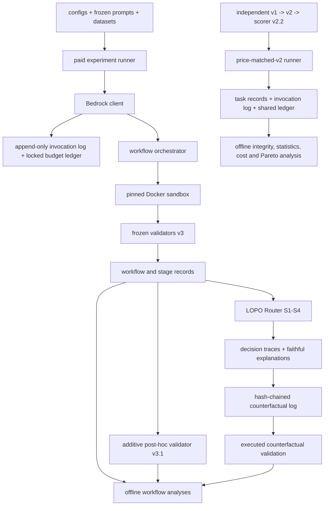

# Model routing and workflow evaluation: final research report

**Report date:** 2026-11-19  
**Scope:** offline synthesis of the committed experiments and derived analyses  
**Evidence vocabulary:** **pre-registered** means that the protocol and analysis rule were frozen before the relevant paid run; **exploratory** means a planned or descriptive analysis without confirmatory power; **post-hoc** means the rule or conversion was introduced after the underlying outcomes existed. These labels describe provenance, not certainty. Small samples make even pre-registered findings exploratory in statistical strength.

## 1. Overview

### Research question

The project asks whether a three-stage data workflow—cleaning, analysis, and reporting—benefits from selecting a different language model at each stage, and whether an explainable router can justify those selections faithfully and predict what would happen under alternative paths. A second, independent benchmark asks how specific callable models behave on debugging (A1), structured extraction (A2), and literature ranking (A3), including quality, stability, latency, and cost.

The central distinction is between three questions:

1. Did a workflow or answer satisfy the frozen correctness rules?
2. Did the router's explanation accurately reproduce the router's own computation?
3. Did the router's counterfactual prediction agree with the executed alternative?

The second can be true while the third is false. That separation is the main XAI contribution of the work.

### What was done

The repository contains a Bedrock client with append-only invocation records and reserve-then-settle budgets; a pinned Docker sandbox for generated Python; a three-stage workflow orchestrator; frozen and additive validators; leave-one-project-out routing strategies S1–S4; tamper-evident decision and counterfactual records; two generations of independent benchmarks; blinded human review; and a price-matched-v2 experiment with 810 scheduled records. The original workflow experiment evaluated all 27 model paths on four synthetic projects, plus pre-registered repeats. All paid-run analyses in this report are recomputed from saved records; no model calls are made by the analysis programs.

### Key conclusions

1. **Frozen strict feasibility was nearly equal on average for single- and cross-model paths, while artifact correction changes that descriptive balance.** In the original 108-cell main grid, frozen v3 found 2/12 single-model and 15/96 cross-model cells feasible; the post-hoc serialization-corrected view keeps single-model feasibility at 2/12 and raises cross-model feasibility to 23/96. In two of four projects, no single-model path succeeded in three frozen attempts while at least one mixed path did. The corrected rates have unequal denominators and do not establish a causal benefit from mixing. **Evidence: frozen result from a pre-registered protocol; corrected view post-hoc.** Sources: `results/processed/workflow_cost_posthoc.json`, repeat-0 `run_costs[*].{project_id,path_id,frozen_v3_outcome}` and repeated path summaries; `results/processed/corrected_q2.json`, `model_groups.original_4096.{single_model_main_grid,cross_model_main_grid}`.

2. **Cleaning was the dominant workflow bottleneck, and upstream data errors propagated into final numbers.** Cleaning was the first failure in 64/108 main runs. Among 20 analyses that received structurally usable but invalid cleaned data, median ground-truth accuracy was 0.10 while median conditional accuracy on the actual input was 1.00. **Evidence: pre-registered.** Source: `results/processed/v3_primary_analysis/path_summary.json`, `rows[*].first_failure_stage`; `results/processed/v3_primary_analysis/propagation.json`, rows selected by `stage`, `quantity`, and `metric`, using `n` and `mean`.

3. **The explanations were computationally faithful but weakly predictive of feasibility.** All 429 checked explanation claims were consistent and all 20 router replays reproduced the selection, yet only 22/50 feasibility counterfactuals had the correct direction. **Evidence: pre-registered.** Source: `results/processed/v3_primary_analysis/faithfulness.json`, `rows[*].{claims_checked,claims_consistent,replay_matches_selection}`; `counterfactual_validity.json`, feasibility rows' `direction_correct`.

4. **The corrected independent-v2 view found one robust A1 pattern, no adjusted A2 difference, and a ceiling-limited A3.** Alias B was lower than A and C on A1 after Holm correction; no A2 or strict-A3 pair survived Holm. Strict invalid-as-zero nDCG@5 was 0.965, 0.958, and 0.732 for A/B/C, but valid rankings were all about 0.99, showing that invalidity—not fine ranking quality—drove much of the spread. **Evidence: post-hoc.** Source: `results/processed/independent_v2/posthoc.json`, `cells` and `paired_statistics`.

5. **In price-matched-v2, A1 and A2 were statistically indistinguishable among the three tested models; A3 separated Kimi K3 and GLM 5.** Strict A3 nDCG@5 was 0.976 for Sonnet 4.6, 0.999 for Kimi K3, and 0.914 for GLM 5; only Kimi-versus-GLM survived Holm (`p_adj = 0.0043`). This is a result about three configurations callable on this account, not vendors. **Evidence: pre-registered.** Source: `results/processed/independent_v2/price_matched_v2_analysis.json`, `main_analysis_void_excluded`.

6. **Executed cost could not be interpreted without feasibility.** Repricing 156 saved workflow runs produced $7.6923 total spend. Frozen v3 found 28/156 feasible completions ($0.2747 per feasible); post-hoc v3.1 found 38/156 ($0.2024 per feasible). Cheap paths often stopped early because an upstream stage failed. **Evidence: post-hoc.** Source: `results/processed/workflow_cost_posthoc.json`, `overall` and `project_path_summaries`.

7. **The post-hoc workflow cost direction was largely explained by unit-price ordering, not by a new predictive achievement.** Token conversion matched executed cost direction in 29/32 estimable pairs; a naive unit-price ordering baseline matched 30/32 on the same pairs (42/50 across all executed-cost pairs). Feasibility direction remained only 22/50. **Evidence: post-hoc.** Source: `results/processed/workflow_cost_posthoc.json`, `cost_counterfactual.summary`.

8. **The post-hoc cost-aware Router changed one of eight selectable traces, but did not improve cost-direction prediction beyond naive price ordering.** Only 8/20 traces could change; customer-churn S2 was the sole change (1/8 selectable, 1/20 overall). Cost direction and the naive unit-price baseline both matched 41/50 pairs, and a PASSED-only cost scope made 0/228 candidate paths cost-estimable and reverted the change. **Evidence: post-hoc.** Source: `results/processed/cost_aware_router_posthoc.json`, `selection_comparison.summary`, `counterfactual_validity.summary`, and `coverage.passed_only_sensitivity.summary`.

9. **The workflow/XAI finding replicated descriptively with a second model group.** The corrected outcome labels remain a Router-validity open item. For Sonnet 4.6, Kimi K3, and GLM 5, the frozen Router was computationally faithful (451/451 claims; 20/20 replay matches) while frozen feasibility-direction accuracy remained 31/64 (48.4%), beside 22/50 (44.0%) in the original group. Frozen v3 found 3/12 single-model and 38/96 cross-model main-grid cells feasible; the post-hoc corrected view finds 6/12 and 46/96. These unequal-denominator rates do not establish a causal mixing benefit. Because corrected labels could change 31/64 and 22/50, their exact effect on Router validity was left uncomputed in the corrected view; it is now computed in conclusion 10. **Evidence: pre-registered protocol; exploratory strength.** **Corrected view: post-hoc.** Sources: `results/processed/price_matched_workflow_v3_summary.json`, `part_b` and `primary_routing`; `results/processed/corrected_q2.json`, `model_groups.price_matched_16384.{single_model_main_grid,cross_model_main_grid}` and `router_validity_open_item`.

10. **Re-scored with corrected labels, the Router's feasibility predictions did no better than always guessing "no change", and many failures were evaluation artifacts.** Corrected labels lowered Router accuracy to 21/50 (original) and 24/64 (price-matched), while the always-tie baseline scored 26/50 and 36/64; the baseline equals or beats the Router in 7 of 8 group/validator/label cells. A failure taxonomy found that artifact-like causes (int64 serialization, truncation, rounding, the known q7 false reject) explain 43/322 original-group and 65/168 price-matched failures excluding blocked stages, and 172/322 and 100/168 including them. **Evidence: post-hoc / exploratory; rules committed before computation.** Sources: `results/processed/router_relabel_posthoc.json`, `model_groups.<group>.validators.<validator>.<frozen|corrected>.slices.pooled.methods`; `results/processed/failure_taxonomy_posthoc.json`, `model_groups.<group>.{artifact_like,artifact_like_excluding_blocked}`.

## 2. Architecture

### System and data flow

The runners construct an `InvocationContext` containing experiment, run, project, path, stage, prompt version, and repeat. `src/bedrock/client.py` sends the exact configured model through Bedrock Converse, applies bounded retries, and never substitutes a model. `src/bedrock/usage.py` writes one invocation record per logical event and holds a worst-case reservation before a call; missing usage is unknown, never zero.

For the workflow experiment, `src/workflow/orchestrator.py` runs cleaning → analysis → reporting. Generated cleaning and analysis code executes in the pinned image through `src/workflow/executor.py`. With `continue_with_actual_artifact`, a downstream stage receives the actual upstream artifact if it is structurally consumable; canonical data is never substituted. Frozen v3 validation is primary. The additive v3.1 rescore changes only the known customer-churn reporting false reject and remains secondary.

Routing is leave-one-project-out. S1 is a single-model baseline, S2 uses independent task evidence, S3 estimates workflow-aware paths, and S4 is a retrospective oracle that is never presented as deployable. Each selection produces a `DecisionTrace`; explanations are template-rendered from that trace. Counterfactual predictions are written to a hash-chained log before held-out outcomes are checked, preventing silent retrospective rewriting.

The independent benchmark is separate from the workflow benchmark. Frozen v1 established the tasks; v2 expanded to 30 cases × 3 models and 270 calls; scorer v2.2 corrected the A3 primary to strict nDCG@5, renamed citation validity, and made all-citation grounding primary without modifying frozen v2 outputs. The price-matched runner then executed 3 models × 3 tasks × 30 cases × 3 repeats in repeat-major order under a shared $100 ledger cap.

### Components

| Component | Responsibility | Integrity boundary |
|---|---|---|
| Bedrock client and ledger | Exact model invocation, retries, provenance, token/cost accounting, hard caps | Append-only invocation JSONL; file-locked reserve-then-settle ledger |
| Sandbox | Executes untrusted model-written Python | Pinned Docker image, resource limits, no canonical-answer substitution |
| Workflow orchestrator | Stage order, handoffs, blocking, resume, records | Frozen contracts and deterministic run/config hashes |
| Validators v3 / v3.1 | Primary prospective scoring / secondary known-bug rescore | v3 never overwritten; v3.1 stored separately |
| Router S1–S4 | LOPO path selection and retrospective reference | Held-out project excluded from S1–S3 training; S4 labeled oracle |
| Decision traces and explanations | Record and render the exact selection computation | Trace hashes, replay checks, claim-by-claim consistency |
| Counterfactual log | Stores prospective alternative-path predictions | Canonical serialization and hash chain before validation |
| Independent v1/v2/v2.2 | Debugging, extraction, and literature evaluation | Versioned prompts/scorers; frozen v2 retained; v2.2 additive |
| Price-matched runner | 810-call repeat-major experiment with checkpoint/resume | Frozen manifest, exact file hashes, shared $100 cap, no selective retries |

### Where things are

| Directory or file | Purpose |
|---|---|
| `configs/` | Model registry, verified prices, experiment/routing settings, frozen plan inputs |
| `datasets/` | Generated workflow projects and independent benchmark cases/ground truth |
| `prompts/` | Versioned workflow and independent prompts |
| `src/bedrock/` | Bedrock Converse client, model registry, retry and budget accounting |
| `src/workflow/` | Stage runners, handoffs, sandbox gate, orchestration |
| `src/evaluation/` | Cleaning, analysis, reporting v2/v3, and workflow validators |
| `src/routing/` and `src/explainability/` | LOPO estimates, S1–S4, traces, explanations, counterfactual validation |
| `src/independent/` | Independent benchmark schemas and frozen/additive scorers |
| `experiments/` | Plan-by-default paid runners and deterministic offline analyzers |
| `sandbox/` | Dockerfile and isolated execution environment |
| `results/raw/` | Immutable paid-call, ledger, record, pricing, access, and pilot evidence |
| `results/routing/` | Traces, explanations, predictions, validations, and chain heads |
| `results/processed/` | Machine-readable derived tables and audits |
| `results/reports/` | Human-readable experiment-specific reports |
| `docs/reviews/` | Checkpoints, independent recomputations, protocol amendments, dispositions |

## 3. Experiment timeline

Costs below are API costs only. “$0 incremental” means an offline audit or analysis reused saved data. “Unavailable” means the original run did not have verified prices; it is not treated as zero.

| Step | Date | Frozen tag or result commit | API cost | Status |
|---|---|---|---:|---|
| Part A: independent workflow-stage evaluation | 2026-11-17 freeze; 2026-11-18 results | `benchmark-v3-frozen` (`22a56e6`); results `a0ccbb6` | Unavailable in the prospective report | 36/36 records; exploratory, one run per cell |
| Part B: full workflow grid and repeats | 2026-11-18 | tag `benchmark-v3-frozen`; results `a0ccbb6` | $7.6923 when repriced post hoc | 108 main + 48 repeat runs; 0 void infrastructure runs |
| Part C: routing and XAI | 2026-11-18 | `5085cfa` | $0 incremental | 20 traces, 50 counterfactual predictions and validations |
| Independent v1 | 2026-11-18 | `independent-v1-frozen` (`45a1d74`); results `f1f50d3` | Unavailable | 90/90 records; 0 void |
| Audit and blinded human review | 2026-11-18 | `236f9b0`, `a070874`, `0fa2738` | $0 incremental | v2 candidate and human label/query review completed |
| Independent v2 | 2026-11-18 | `independent-v2-frozen-v1.1` (`3b6bea4`); results tag `independent-v2-results-v1.1` (`719ec13`) | $1.1181 | 270/270 calls; audit passed |
| Independent-v2 post-hoc analysis | 2026-11-18 | rules `ca9cce2` + amendment `108df1f` | $0 incremental | Strict A3, location normalization, paired statistics |
| Tier-matched plan | 2026-11-18 | CP3 plan `f698ddf`; superseded at `b01c8c5` | $0 | Abandoned before calls: 4/5 rule-selected models unavailable on the account |
| Price-matched-v2 pilot and model swap | 2026-11-18 | pilot `afff4c9`; probes `85b7bd6`; re-pilot `f582184` | Included in shared ledger | Grok removed after real-invoke denial; Kimi no-temperature and GLM 5 re-pilot 6/6 |
| Price-matched-v2 main experiment | 2026-11-18 | `price-matched-v2-frozen-v1`, amended `price-matched-v2-frozen-v1.1` (`d8d7539`); results `a7a37a9` | $23.9092 shared ledger, including pilots and conservative failed-attempt reservations | 810 records: 798 passed, 10 failed, 2 void infrastructure; integrity audit passed |
| Workflow cost analysis | 2026-11-19 | `1e0cc68` plus this report's naive-baseline amendment | $0 incremental; analyzes $7.6923 executed spend | Post-hoc/exploratory; v3 and v3.1 denominators side by side |
| CP6: post-hoc cost-aware Router | 2026-11-19 | rules `13cecea`; results and review `ca5a704` | $0 incremental | Post-hoc/exploratory; 20 traces, with 1/8 selectable traces changed |

Timeline sources: Git objects named in the table; `results/processed/independent_v2/analysis.json`, `audit.totals`; `results/processed/independent_v2/price_matched_v2_analysis.json`, `integrity_audit.{record_counts,cost_reconciliation}`; `results/processed/workflow_cost_posthoc.json`, `overall.total_spend_usd`; and `results/processed/cost_aware_router_posthoc.json`, `integrity_audit.n_traces` and `selection_comparison.summary`.

## 4. Results

### Part A: independent workflow stages

Each cell contains four projects and one run per project. A pass requires parsing, successful execution where applicable, and every mandatory validator check.

| Stage | Sonnet 4.6 (A) | Nova Pro (B) | gpt-oss-120b (C) |
|---|---:|---:|---:|
| Cleaning | 3/4 | 0/4 | 2/4 |
| Analysis | 4/4 | 0/4 | 4/4 |
| Reporting, frozen v3 | 3/4 | 2/4 | 2/4 |

**Machine-readable source:** `results/reports/phase1_tables.json`, `cells["<stage>|<alias>"].{n,passed,pass_rate}`. The report generator is deterministic and records the hashes of its raw sources in `sources`.

The table shows task specialization, not an overall ranking. Nova was fastest in the original stage report but its cleaning and analysis code did not pass. gpt-oss matched Sonnet on analysis but two cleaning responses were truncated at the common 4,096-token limit. The reporting table also contains the known customer-churn q7 validator false reject; v3.1 is discussed below rather than substituted into this primary table.

### Part B: end-to-end workflows

| Result | Frozen-v3 finding | Source path and fields |
|---|---:|---|
| Main single-model feasibility | 2/12 (16.7%) | `results/processed/workflow_cost_posthoc.json`, repeat-0 `run_costs` for `A-A-A`, `B-B-B`, `C-C-C`: `frozen_v3_outcome` |
| Main cross-model feasibility | 15/96 (15.6%) | Same file, repeat-0 `run_costs` for the other 24 paths |
| Projects where a mixture succeeded but no single model did in 3 attempts | 2/4 | Same file: `project_path_summaries[*].{project_id,path_id,n_runs,frozen_v3.n_feasible}` |
| First failure: cleaning / analysis / reporting / none | 64 / 13 / 14 / 17 of 108 | Same file, repeat-0 `run_costs[*].stages[*].{stage,status}` and `frozen_v3_outcome` |
| Bad-but-usable cleaned inputs reaching analysis | 20 | `results/processed/v3_primary_analysis/propagation.json`, relevant `rows` |
| Median ground-truth / conditional analysis accuracy in those 20 | 0.10 / 1.00 | Same file, analysis/numerical-accuracy rows: `quantity`, `metric`, `n`, and distribution fields |
| Repeated cells with identical / changing outcomes | 18 / 6 of 24 | `results/processed/v3_primary_analysis/variability.json`, feasibility rows: `n`, `min`, `max`, `spread` |

The average single/cross rates are nearly equal, but aggregation hides project dependence. Customer churn and energy consumption had no successful single-model path across three repeats, yet several mixed paths succeeded. Retail sales favored A-A-A (3/3), while support operations, the two-file join, was difficult for almost every path. These are descriptive results over four synthetic projects.

The error-propagation result is especially important: analysis code was often correct for the corrupted file it received even when final answers were wrong against ground truth. It therefore would be misleading to label the entire downstream error as an analysis-model failure or a pure “handoff cost.”

### Part C: routing and XAI

| Check | Result | Machine-readable source |
|---|---:|---|
| S3 selected an executed-feasible path | 3/4 held-out projects | `results/processed/v3_primary_analysis/strategies.json`, S3 rows: `executed_outcome_label` |
| S2 selected an executed-feasible path | 0/4 | Same file, S2 rows |
| Explanation claims consistent | 429/429 | `results/processed/v3_primary_analysis/faithfulness.json`, sum of `claims_consistent/claims_checked` |
| Replays matching selection | 20/20 | Same file, `replay_matches_selection` |
| Feasibility counterfactual direction correct | 22/50 (44%) | `results/processed/v3_primary_analysis/counterfactual_validity.json`, feasibility rows: `direction_correct` |
| Feasibility interval covered actual | 48/50 | Same file: `interval_covers_actual` |

S4 is a retrospective oracle and not a deployable comparison. S3's 3/4 is also based mostly on one executed run per selected path; the repeat table above shows that 6/24 repeated cells changed outcome even at temperature zero. The defensible conclusion is not that S3 is established as superior, but that the explanation machinery was faithful to its computation while its decision-relevant feasibility predictions transferred poorly.

### Original-v1 independent benchmark

The original benchmark had ten cases per task and one call per model/case. Prices were not verified, so cost is unavailable.

| Task and primary measure | Sonnet 4.6 (A) | Nova Pro (B) | gpt-oss-120b (C) |
|---|---:|---:|---:|
| A1 functional correctness | 10/10 | 9/10 | 10/10 |
| A2 all fields correct | 10/10 | 6/10 | 3/10 |
| A3 nDCG@5 mean among stored v1 scores | 0.995 | 0.962 | 0.992 |
| A3 valid hard-pass responses | 10/10 | 10/10 | 5/10 |

**Machine-readable source:** `results/processed/independent/tables.json`: A1 `cells.a1|*.functional_correct`; A2 `cells.a2|*.all_fields_correct`; A3 `cells.a3|*.{ndcg_at_5_mean,hard_pass}`.

The A3 mean alone is misleading for C because invalid and truncated responses reduce availability while the valid rankings are near the ceiling. V1 and later results use different protocols and must not be treated as a longitudinal model leaderboard.

### Independent-v2 and post-hoc correction

Independent v2 used 30 cases per task and one call per alias/case. The run itself was prospective and cost $1.1181, but the normalized location categories and corrected A3 views below are post-hoc.

| Task | A | B | C | Interpretation |
|---|---:|---:|---:|---|
| A1 frozen functional correctness | 0.900 | 0.567 | 0.867 | Only A–B (`p_adj=0.0059`) and B–C (`p_adj=0.0078`) survive Holm |
| A1 normalized location recall | 0.650 | 0.617 | 0.150 | C has 42 format mismatches; this is reporting-format behavior, not evidence of weak localization ability |
| A2 frozen content correctness | 1.000 | 0.833 | 1.000 | No pair survives Holm; B's five errors are 2 omissions and 3 unit/scale conversions |
| A3 **strict** nDCG@5, invalid = 0 | 0.965 | 0.958 | 0.732 | Primary corrected view; no pair survives Holm |
| A3 deduplicated-first-5 nDCG@5 | 0.997 | 0.990 | 0.954 | Secondary ceiling-limited view |
| A3 valid-ranking-only nDCG@5 | 0.998 | 0.991 | 0.998 | Demonstrates the ceiling among valid responses |
| A3 relaxed R1 all-citation grounding | 0.022 | 0.281 | 0.456 | Post-hoc vocabulary/attribute diagnostic, not comparable to price-matched v2.2 grounding |

**Machine-readable source:** `results/processed/independent_v2/posthoc.json`: `cells`, including `format_mismatch`, `normalized_location_recall`, `ranking_ndcg`, and `grounding`; adjusted tests in `paired_statistics`.

The frozen v2 A3 formula was defective: `frozen_all_case` nDCG exceeded 1 for 1 A record, 1 B record, and 3 C records. Its cell means (1.0016, 0.9948, 0.9686) are retained only as audit evidence and are not headlines. Strict invalid-as-zero nDCG@5 is the primary result above. Scorer v2.2 implements that rule additively; it does not rewrite frozen v2 outputs.

### Price-matched-v2 benchmark

The final set was Sonnet 4.6, Kimi K3, and GLM 5: three specific models available to this account after real-invoke probes. There were 90 scheduled records per task/model. The main analysis excludes two network-caused A1 void-infrastructure cells (denominators 89 for Sonnet and GLM); the sensitivity treating them as failures changes those means by roughly one percentage point and does not change the conclusions.

| Task / model | Analyzed n | Primary quality | Operational rate | Known-response spend | Ledger-attributed spend | Median latency |
|---|---:|---:|---:|---:|---:|---:|
| A1 Sonnet 4.6 | 89 | 0.899 functional correct | 1.000 | $0.6155 | $1.9958 | 3.38 s |
| A1 Kimi K3 | 90 | 0.900 | 0.989 | $3.6850 | $4.5132 | 7.25 s |
| A1 GLM 5 | 89 | 0.865 | 1.000 | $0.0975 | $0.3684 | 3.46 s |
| A2 Sonnet 4.6 | 90 | 1.000 content correct | 1.000 | $0.2328 | $0.2328 | 1.05 s |
| A2 Kimi K3 | 90 | 0.989 | 1.000 | $1.0651 | $1.0651 | 1.80 s |
| A2 GLM 5 | 90 | 1.000 | 1.000 | $0.0478 | $0.0478 | 1.45 s |
| A3 Sonnet 4.6 | 90 | 0.976 strict nDCG@5 | 0.978 | $2.8298 | $2.8298 | 8.30 s |
| A3 Kimi K3 | 90 | 0.999 | 1.000 | $11.6981 | $11.6981 | 31.51 s |
| A3 GLM 5 | 90 | 0.914 | 0.922 | $0.4867 | $0.4867 | 15.54 s |

**Machine-readable source:** `results/processed/independent_v2/price_matched_v2_analysis.json`, `main_analysis_void_excluded.cells[*].{analyzed_denominator,primary_mean,operational_rate,known_response_cost_usd,actual_execution_cost_usd,latency_ms.median}`. “Ledger-attributed” includes conservative reservations for failed network attempts; known-response spend uses returned usage only. The integrity totals are `integrity_audit.cost_reconciliation`.

No A1 or A2 pair survived the pre-defined Holm families. In A3, only Kimi K3 versus GLM 5 survived (`p_adj=0.0042749`); Sonnet versus GLM did not after adjustment (`p_adj=0.0700`). The per-task Pareto sets were all three models for A1 and A3, and GLM alone for A2 (`main_analysis_void_excluded.pareto_frontier_by_task`).

Known-response spend across all three tasks was $3.6781 for Sonnet, $16.4482 for Kimi, and $0.6320 for GLM. Thus Kimi cost about 4.5× Sonnet despite the same published input/output unit prices, while GLM cost about 5.8× less than Sonnet. The reason is observed token volume: scheduled-call mean billed output was about 2,393 versus 326 tokens in A1 and 7,509 versus 1,482 in A3 for Kimi versus Sonnet, respectively. Kimi returned reasoning text in 90/90 records per task: median reasoning length was 5,583.5 / 1,108.5 / 27,467 characters for A1/A2/A3, while its final answers were only 1,180.5 / 209 / 4,385 characters—close to Sonnet's 1,036 / 210 / 4,159. At an explicitly approximate four characters per token, Kimi's A3 answer plus reasoning is about 7,963 tokens, close to the 7,718 median billed output tokens. Thus Kimi's extra billed output mainly consists of the reasoning text it returns; Bedrock does not report a separate reasoning-token count, and the character conversion is descriptive rather than authoritative. Source: `results/processed/independent_v2/price_matched_v2_analysis.json`, `output_composition.{char_to_token_approximation,kimi_vs_sonnet}`; billed totals remain in each main-analysis cell's `output_tokens_including_reasoning_known` and `scheduled`.

A1 normalized bug-location recall was 0.612 for Sonnet, 0.800 for Kimi, and 0.163 for GLM (`secondary_metrics.bug_location_recall`). As in the earlier C result, the low GLM value is dominated by formatting of names/anchors and is not evidence of poor localization skill. A3 exact cross-repeat consistency was 0.900 for Sonnet, 0.967 for Kimi, and 0.633 for GLM (`repeat_stability[*].exact_consistency_rate`). GLM used temperature zero while Kimi omitted the unsupported temperature field; the stability observation is descriptive, not a causal temperature comparison.

Original v1 and price-matched-v2 are not directly comparable: the case sets, prompts, scorer, output budget, models, and repeat structure differ. Sonnet 4.6 is a bridge configuration only; its strong performance in both does not convert the two protocols into a time series.

### Replication with a second model group

The workflow and routing protocol was repeated with Sonnet 4.6, Kimi K3, and GLM 5—three specific models callable on this account. The main grid used the same four projects and 27 paths, but `maxTokens=16384` rather than the original group's 4096; Kimi omitted the unsupported temperature field while Sonnet and GLM used temperature zero. Five Docker-caused `void_infra` cells were rerun once, outcome-blind and append-only, with their originals retained. Primary v3 found 41/108 feasible main-grid cells; post-hoc v3.1 found 53/108. Under primary v3, single-model paths were feasible in 3/12 cells and cross-model paths in 38/96. That observed direction differs from the original group's near-equality, but the denominators are unequal and this is a descriptive replication, not evidence that mixing models caused higher feasibility. Source: `results/processed/price_matched_workflow_v3_summary.json`, `integrity_audit.rerun_resolution` and `part_b.{main_grid,single_model_main_grid,cross_model_main_grid}`.

The retrained LOPO Router used only the new records. Its explanations were computationally faithful—451/451 claims consistent and 20/20 replay matches—while feasibility direction matched 31/64 counterfactual pairs (48.4%), beside 22/50 (44.0%) in the original model group. Thus “faithful but not empirically valid” holds descriptively for feasibility direction in the second group, with different denominators and no causal or provider-wide claim. Both prediction and validation hash chains verify, and no held-out evidence reference was found. Source: `results/processed/price_matched_workflow_v3_summary.json`, `primary_routing`; routing artifacts are under `results/routing/price_matched_workflow_v3_primary/`.

Effective Part B spend was $23.2235 across 156 runs; cost per feasible completion was $0.3807 under v3 and $0.3016 under v3.1. In the separately labelled post-hoc cost-aware Router, token-based cost direction matched 64/64 pairs, compared with 56/64 for naive unit-price ordering. Unlike the original group, token-based prediction therefore exceeded price ordering on this sample. A plausible descriptive mechanism is that Kimi K3 and Sonnet 4.6 share published input/output unit prices but produced different token volumes; this was not pre-registered as a causal test. Source: `results/processed/price_matched_workflow_v3_summary.json`, `costs`; `results/processed/price_matched_workflow_v3_cost_posthoc.json`, `counterfactual_validity.summary`.

### Corrected view (post-hoc)

This additive sensitivity view diagnoses two known evaluation artifacts without replacing any frozen record or conclusion. Q1 compares five stage-level views side by side. Across both model groups and Parts A/B, mutually exclusive attribution adds 55 NumPy-int64 serialization recoveries, 15 stated-precision rounding recoveries, and 30 separate v3.1 recoveries. The clearest Part A change is GLM 5 analysis, from 0/4 frozen passes to 4/4 in the combined view. Source: `results/processed/corrected_view.json`, `assertions.total_attribution_counts` and `model_groups.price_matched_16384.parts.part_a.stages.analysis.models.C.{denominator,frozen,combined}`.

Q2 uses the completed continuations for exact end-to-end sensitivity: 40/40 analysis-recovery cells have a new reporting outcome, 11/11 cleaning recoveries retain their observed downstream outcomes, and one workflow cell belongs to both evidence sets. All 11 cleaning-recovery handoffs showed the downstream stages an upstream `failed` label, so those results remain explicitly conditional on that prompt context. There were 0 continuation infrastructure voids; the separate ledger recorded 40 calls, 0 failed attempts, and $1.3974. Source: `results/processed/corrected_q2.json`, `integrity_audit.{continuation_records,cleaning_recoveries_with_observed_downstream,cleaning_and_analysis_recovery_overlap,cleaning_recovery_downstream_saw_failed_label,continuation_void_infra,ledger}`.

| Model group | View | Frozen main-grid feasible | Corrected main-grid feasible | Frozen single / cross | Corrected single / cross |
|---|---|---:|---:|---:|---:|
| Original, 4096 | v3 primary | 17/108 | 25/108 | 2/12 / 15/96 | 2/12 / 23/96 |
| Original, 4096 | v3.1 secondary | 21/108 | 30/108 | 3/12 / 18/96 | 3/12 / 27/96 |
| Price-matched, 16384 | v3 primary | 41/108 | 52/108 | 3/12 / 38/96 | 6/12 / 46/96 |
| Price-matched, 16384 | v3.1 secondary | 53/108 | 70/108 | 4/12 / 49/96 | 7/12 / 63/96 |

Every numerator and denominator in this table comes from `results/processed/corrected_q2.json`, `model_groups.<group>.{main_grid,single_model_main_grid,cross_model_main_grid}`. Per-project/path outcomes and the exact 9 original-group and 17 price-matched main-grid paths whose v3 or v3.1 outcome changed are in `project_path_outcomes_main_grid` and `changed_paths_main_grid`, respectively. First-failure distributions are in `first_failure_stage_main_grid`.

Corrected cost retains the failed original calls and adds every continuation call. Across all 156 effective cells, original-group spend rises from $7.6923 to $7.9179 and corrected cost per feasible completion is $0.2199 under v3 and $0.1650 under v3.1; price-matched spend rises from $23.2235 to $24.3953 and the corresponding corrected costs are $0.3168 and $0.2440. Source: `results/processed/corrected_q2.json`, `model_groups.<group>.costs.all_effective.{base_spend_usd,corrected_total_spend_usd,corrected_v3,corrected_v31}`.

Q1's rounding recovery is not applied to Q2. The frozen Router artifacts are also not retrained or rescored: corrected labels may change the published 22/50 and 31/64 feasibility-direction counts, but that is recorded only as an open item. Source: `results/processed/corrected_q2.json`, `rules.rounding_recovery_applied_to_q2` and `router_validity_open_item`. That open item was later closed by a separate post-hoc re-scoring; see "Router re-scoring with corrected labels (post-hoc)" below.

### Workflow cost analysis

This post-hoc analysis applies the verified A/B/C prices in `configs/models.yaml` to every saved Part B attempt, including failed attempts. Usage is complete for all 156 runs.

| View | Feasible / non-void | Feasibility | Total spend | Cost per feasible completion |
|---|---:|---:|---:|---:|
| Frozen v3, primary | 28/156 | 17.9% | $7.6923 | $0.2747 |
| Post-hoc v3.1, secondary | 38/156 | 24.4% | $7.6923 | $0.2024 |

**Machine-readable source:** `results/processed/workflow_cost_posthoc.json`, `overall.{frozen_v3,posthoc_v31,total_spend_usd}`. Spend is identical; only feasibility labels and therefore success denominators differ.

The pooled cost–feasibility frontier contains C-C-C at $0.00468/run with 0/12 feasible and C-C-B at $0.01036/run with 3/4 feasible under both views. The first point is inexpensive largely because downstream calls are blocked after early failure. It must not be described as the “cheapest combination” without its 0/12 denominator. Project-level frontier cells are mostly **single-run evidence**. Source: `pareto_frontiers.{pooled_posthoc_view,per_project}`.

The validator sensitivity is concentrated enough to change an operational conclusion: customer-churn A-A-A is 0/3 feasible under frozen v3 and 3/3 under v3.1 at the same $0.4620 total spend. Source: `project_path_summaries`, row `project_id=customer_churn,path_id=A-A-A`.

The cost-first sensitivity was estimable for only 8/20 traces because token predictions were often unavailable, and it changed 1/20 frozen selections. The cost-counterfactual conversion matched 29/32 executed directions. A deliberately naive baseline—sum of each path's three input-plus-output unit prices, ignoring token volume—matched 30/32 on the same pairs and 42/50 wherever executed costs were comparable. This makes the proper interpretation explicit: cost direction was largely price-ordered, whereas the frozen router's feasibility direction was correct only 22/50. Source: `router_cost_first_sensitivity.summary` and `cost_counterfactual.summary`.

One procedural limitation applies to this analysis: the dated v3/v3.1 rules amendment existed in the working tree before computation, but it and the computed results were committed together. The commit history therefore does not independently prove the required “commit rules before computing” order; that order rests on the execution log and mutual review. This does not alter the saved inputs or arithmetic, but it weakens the procedural audit trail.

### Post-hoc cost-aware Router variant

This variant is **post-hoc / exploratory**. It reran S1–S3 offline with direct input/output-token prices while retaining the frozen feasibility and quality constraints. Of 20 traces, 8 had a frozen selection that could possibly change and 12 had no feasible path; one of the 8 selectable traces changed (1/20 overall), at the explicit cost-preference step rather than the Pareto filter. Source: `results/processed/cost_aware_router_posthoc.json`, `selection_comparison.summary.{n_traces,n_could_change,n_no_feasible_frozen,n_selection_changes,change_causes}`.

The single change was customer-churn S2. The frozen choice A-C-A cost $0.11168 per run over three cost-complete runs and was feasible in 0/3 under frozen v3 but 2/3 under post-hoc v3.1. Source: `results/processed/workflow_cost_posthoc.json`, `project_path_summaries`, row `project_id=customer_churn,path_id=A-C-A`, fields `mean_cost_per_run_usd`, `n_cost_complete`, `frozen_v3.{n_feasible,n_nonvoid}`, and `posthoc_v31.{n_feasible,n_nonvoid}`. The cost-aware choice C-C-A cost $0.05126 in its one observed run and was feasible in 0/1 under both v3 and v3.1; it is explicitly **single-run evidence**. Source: `results/processed/cost_aware_router_posthoc.json`, `selected_path_outcomes`, row `target_project=customer_churn,strategy=S2_greedy_task_only`, fields `selected_path_id` and `executed.{mean_cost_usd,n_cost_complete,v3,v31,evidence_label}`. Thus the cheaper selection failed in its observed run, whereas the frozen choice succeeded in 2/3 runs under v3.1; this is a concrete cost–reliability trade-off, not evidence that the variant is preferable.

Cost-counterfactual direction matched 41/50 pairs, exactly the same as the naive unit-price-ordering baseline's 41/50 on that subset; the Router added no predictive value beyond price ordering for cost direction in this sample. Feasibility direction matched only 23/50. Source: `results/processed/cost_aware_router_posthoc.json`, `counterfactual_validity.summary.{cost_direction,naive_price_ordering_same_subset,feasibility_direction}`.

The result also depends on the cost-scope rule. The primary rule includes all non-void executed PASSED and FAILED stage records. Under the PASSED-only sensitivity, only 60/108 stage/model/fold cells had complete evidence, leaving 0/228 complete candidate-path cost estimates and no active cost step; the sole primary change reverted to A-C-A. Source: `results/processed/cost_aware_router_posthoc.json`, `coverage.passed_only_sensitivity.{stage_cells,summary}` and `passed_only_sensitivity.{summary,rows}`. The reported selection change therefore should not be generalized independently of the chosen cost-evidence scope.

### Router re-scoring with corrected labels (post-hoc)

This analysis closes the open item recorded in the corrected view. It is **post-hoc / exploratory / retrospective**: the frozen Router predictions were not retrained or changed; they were only re-scored against the corrected executed outcomes, beside four naive baselines (always-less, always-more, a training-only stage-rate baseline, and always-tie, which predicts no feasibility change). The rules were committed before computation in `docs/ROUTER_RELABEL_RULES.md`. A reproduction gate first re-derived the frozen counts exactly (50/50 and 64/64 validations; pooled 22/50 and 31/64). Source: `results/processed/router_relabel_posthoc.json`, `reproduction_gate`.

| Model group | Validator | Router, frozen labels | Router, corrected labels | Always-tie, frozen labels | Always-tie, corrected labels |
|---|---|---:|---:|---:|---:|
| Original, 4096 | v3 primary | 22/50 | 21/50 | 27/50 | 26/50 |
| Original, 4096 | v3.1 secondary | 22/50 | 20/50 | 23/50 | 22/50 |
| Price-matched, 16384 | v3 primary | 31/64 | 24/64 | 30/64 | 36/64 |
| Price-matched, 16384 | v3.1 secondary | 27/64 | 20/64 | 40/64 | 46/64 |

Every count is from `results/processed/router_relabel_posthoc.json`, `model_groups.<group>.validators.<validator>.<frozen|corrected>.slices.pooled.methods.{router,d_always_tie}.{k,n}`. Per-strategy, per-project and other-baseline rows, with Wilson intervals, are in the same `slices` objects and in `results/reports/router_relabel_posthoc.md`.

- **The trivial always-tie baseline is at least as accurate as the Router in 7 of the 8 group/validator/label cells.** The only exception is price-matched frozen v3, where the Router leads 31/64 to 30/64.
- **Corrected labels lowered Router accuracy in every group and validator**, for example from 31/64 to 24/64 in the price-matched v3 view, while always-tie rose to 36/64.
- The Router beats only the always-more baseline by a wide margin. Its margin over the other baselines is small or negative.
- The intervals treat predictions as independent although they are clustered by project and strategy, so they are optimistic. Corrected labels depend on the 40 continuation calls and on the 11 cleaning recoveries whose downstream stages saw an upstream `failed` label; they are a sensitivity, not a reconstruction.

This strengthens conclusions 3 and 9: the explanations remain computationally faithful, but the Router's feasibility predictions add no demonstrated value over a constant guess. Nothing here shows the Router repaired, validated or deployable.

### Failure-cause taxonomy (post-hoc)

Every non-passed stage opportunity was assigned to one mutually exclusive category by the precedence rules committed before computation in `docs/FAILURE_TAXONOMY_RULES.md`. Categories describe saved evidence, not proven root causes. Source: `results/processed/failure_taxonomy_posthoc.json`, `model_groups.<group>.{counts,artifact_like,artifact_like_excluding_blocked,blocked_share,model_behaviour_like,residual_all_units,residual_failed_only}`; rendered tables in `results/reports/failure_taxonomy_posthoc.md`.

| Model group | Non-passed units | Artifact-like, incl. blocked | Artifact-like, excl. blocked | Blocked / not run upstream | Model-behaviour-like (by failure type) |
|---|---:|---:|---:|---:|---:|
| Original, 4096 | 322 | 172/322 (53.4%) | 43/322 (13.4%) | 129/322 (40.1%) | 150/322 (46.6%) |
| Price-matched, 16384 | 168 | 100/168 (59.5%) | 65/168 (38.7%) | 35/168 (20.8%) | 68/168 (40.5%) |

- **Artifacts were a large share of failures, larger in the price-matched group.** Excluding blocked stages, NumPy int64 serialization, truncation, reporting rounding and the known q7 false reject account for 13.4% of original-group failures and 38.7% of price-matched failures. GLM 5's analysis failures were almost all int64 serialization (31 of 33 in Part B; 4 of 4 in Part A).
- **Blocked stages have different upstream roots by group.** In the original group, most blocked stages trace back to execution errors (78 of 129); in the price-matched group most trace back to int64 serialization (29 of 35). Source: `blocked_upstream_root`.
- **`genuine_validator_mismatch` is a broad catch-all** (81 and 66 units). It means a mandatory check failed; it does not assign fault to the model or to the validator. The "model-behaviour-like" column is grouped by failure type only, not a finding that the model was wrong.
- **The 0 unexplained residual** (0/322 and 0/168) follows from the precedence rules, because every failed record carries a `failure_type` that maps to a category. It is not evidence that every failure is understood.

## 5. Limitations and disclosures

- **Benchmark-author bias.** The benchmark, prompts, validators, and analyses were developed with substantial Claude/Codex assistance, while a Claude model is one evaluated configuration. Even with frozen rules and human review, task design may favor conventions familiar to the authoring systems.
- **Account-constrained model selection.** The tier-matched plan was abandoned because four of five rule-selected models were unavailable. Grok 4.7 was removed after a real invocation returned `AccessDeniedException`, despite control-plane availability. GLM 5 was chosen over Mistral Large for generation match, not closer price match.
- **Price matching is approximate.** The final models span about 4.3× in verified unit price. “Price-matched-v2” denotes the documented selection process, not equal prices. Observed total spend diverged further because output-token volume differed.
- **Kimi parameter deviation.** Kimi K3 rejected the temperature field during the pilot, so it ran without that field; Sonnet and GLM retained temperature zero. Every other approved parameter stayed fixed. This model-specific difference is documented and prevents a pure controlled temperature comparison.
- **Known validator false rejects.** Frozen reporting v3 misattributes a comparative percentage in customer-churn q7. V3.1 corrects that known pattern only and is secondary. The 28/156 versus 38/156 workflow feasibility difference shows that validator choice is consequential; unknown validator errors may remain.
- **A3 ceiling and validity.** Ranking quality is near 1.0 among valid responses in several analyses. Strict invalid-as-zero nDCG is therefore driven partly by response validity. The frozen v2 A3 formula could exceed 1 and is retained only for audit; v2.2 strict nDCG is the headline.
- **Small samples and single-run evidence.** Part A has four projects and one run per cell; most workflow paths have one run; routing has four held-out projects. Temperature-zero outputs still varied. Project-level Pareto points explicitly label single-run evidence.
- **Synthetic and pilot-exposed data.** The four workflow projects are synthetic. `retail_sales` was exposed during pilot development, so pooled results are not wholly untouched by earlier runs.
- **Post-hoc analyses.** V3.1 rescoring, normalized A1 locations, A3 diagnostic views, dollar conversion of workflow tokens, cost-first routing sensitivity, Pareto cost views, the naive price-ordering baseline, the corrected-label Router re-scoring, and the failure-cause taxonomy are post-hoc/exploratory. The re-scoring and taxonomy were computed by a Claude-based executor agent (Claude is one of the evaluated model families) because Codex's budget was exhausted; their rules were committed before computation, a separate read-only Claude reviewer audited the outputs, and tests check the reproduction gate and reconciliation counts. They do not become prospective by being deterministic.
- **Frozen tree-hash reproducibility.** Two untracked `datasets/independent_v2/__pycache__/*.pyc` files entered the legacy frozen dataset-tree hash, so a clean checkout cannot reproduce that byte-for-byte value. The additive amendment keeps every frozen value unchanged and accepts dataset equivalence only when the manifest still matches the recorded legacy value, the bytecode-excluded tree matches the recorded tracked-only value, and the original repository's tag-to-HEAD Git evidence shows no tracked dataset change. That historical equivalence depends on retaining the original repository history. Source: `results/processed/hash_reproducibility_amendment.json`, `tree_hashes` and `history_dependency`; method: `docs/HASH_REPRODUCIBILITY_AMENDMENT.md`.
- **Cost accounting boundaries.** Price-matched known-response cost and conservative ledger cost answer different questions. Failed attempts without usage are reserved at worst case rather than silently assigned zero. Original v1 and Part A costs remain unavailable in their prospective reports.
- **Void infrastructure handling.** The two price-matched A1 network failures were excluded from primary denominators and included as failures in sensitivity. They were not rerun, avoiding an unplanned selective retry.
- **No provider-wide inference.** Results describe named model versions, prompts, parameters, tasks, region, and this account's access. They do not establish a general provider ranking.
- **Mutual-review limits.** Claude served as manager/reviewer and independently recomputed selected totals; Codex implemented and analyzed. This caught several protocol and bookkeeping issues, but both systems shared the repository, source assumptions, and much of the same model family context. It is stronger than unreviewed self-report, but not independent replication by a separate research team.

## 6. Verification guide

All commands below are offline. They may regenerate derived files under `results/processed/` or `results/reports/`, but do not invoke Bedrock. Run them from the repository root with the existing virtual environment.

### Environment and integrity checks

| Purpose | Command | File / field to inspect |
|---|---|---|
| Full offline test suite | `.venv/bin/python -m pytest -q` | Terminal summary; paid live tests should be skipped |
| Workflow raw-record reconciliation | `.venv/bin/python -m experiments.reconcile_records --experiment expA_stage_v3 --experiment expB_paths_v3` | Printed `problems=[]`; `results/processed/reconciliation.json` |
| Price-matched frozen tag and manifest | `git show-ref --verify refs/tags/price-matched-v2-frozen-v1.1 && git show price-matched-v2-frozen-v1.1:results/processed/independent_v2/price_matched_v2_protocol_manifest.json >/tmp/price_matched_v2_protocol_manifest.json && .venv/bin/python -m json.tool /tmp/price_matched_v2_protocol_manifest.json >/dev/null` | All commands exit zero; inspect the manifest's `status`, `protocol_hashes`, and `amendments` at that tag |
| Frozen-hash reproducibility amendment | `.venv/bin/python -m experiments.verify_frozen_hashes` | Printed `status=pass`, `frozen_manifests_checked=4`, and empty `errors`; evidence is in `results/processed/hash_reproducibility_amendment.json` |

### Conclusion-by-conclusion checks

| Conclusion | One reproduction command | File and exact field(s) to check |
|---|---|---|
| 1. Single vs mixed workflow feasibility | `.venv/bin/python -m experiments.analyze_workflow_cost_posthoc` | `results/processed/workflow_cost_posthoc.json`, repeat-0 `run_costs[*].{path_id,frozen_v3_outcome}`; aggregate the three single paths versus the other 24 |
| 2. Cleaning bottleneck and propagation | `.venv/bin/python -m experiments.analyze_results --config configs/analysis_v3.yaml` (rewrites `results/processed/v3_primary_analysis/`; pass `--generated-at` with the committed timestamp to avoid a timestamp-only diff) | `results/processed/v3_primary_analysis/path_summary.json`, `first_failure_stage`; `propagation.json`, rows selected by `{stage,quantity,metric}` and their `{n,mean,min,max}` |
| 3. Faithful explanations, weak feasibility validity | Same command as conclusion 2 | `results/processed/v3_primary_analysis/faithfulness.json`, sums of `claims_*` and replay booleans; `counterfactual_validity.json`, feasibility `direction_correct` |
| 4. Corrected v2 significance and A3 ceiling | `.venv/bin/python -m experiments.analyze_independent_v2_posthoc` | `results/processed/independent_v2/posthoc.json`, `cells.*.ranking_ndcg` and `paired_statistics` |
| 5. Price-matched quality, cost, stability, statistics | `.venv/bin/python -m experiments.analyze_price_matched_v2` | `results/processed/independent_v2/price_matched_v2_analysis.json`, `main_analysis_void_excluded`, `repeat_stability`, `integrity_audit` |
| 6. Workflow cost per feasible completion | `.venv/bin/python -m experiments.analyze_workflow_cost_posthoc` | `results/processed/workflow_cost_posthoc.json`, `overall` and `pareto_frontiers` |
| 7. Token conversion versus naive price baseline | `.venv/bin/python -m experiments.analyze_workflow_cost_posthoc` | Same file, `cost_counterfactual.summary.{n_direction_matches,naive_price_ordering_baseline,frozen_router_feasibility_direction}` |
| 8. Post-hoc cost-aware Router | `tmpdir="$(mktemp -d)" && .venv/bin/python -m experiments.analyze_cost_aware_router_posthoc --out "$tmpdir/routing" --processed "$tmpdir/analysis.json" --report "$tmpdir/report.md" && echo "$tmpdir"` | Generated `analysis.json`: `selection_comparison.summary`, `selected_path_outcomes`, `counterfactual_validity.summary`, `coverage.passed_only_sensitivity`, and `passed_only_sensitivity` |
| 9. Replication with a second model group | `tmpdir="$(mktemp -d)" && .venv/bin/python -m experiments.analyze_price_matched_workflow_v3 --out "$tmpdir/summary.json" --report "$tmpdir/report.md" --cost-routing "$tmpdir/cost-routing" --cost-processed "$tmpdir/cost.json" && echo "$tmpdir"` | Generated `summary.json`: `integrity_audit.rerun_resolution`, `part_b.{main_grid,single_model_main_grid,cross_model_main_grid}`, `primary_routing.{faithfulness,feasibility_direction}`, and `costs`; generated `cost.json`: `counterfactual_validity.summary` |
| Corrected view (post-hoc Q1/Q2) | `.venv/bin/python -m experiments.analyze_corrected_view && .venv/bin/python -m experiments.analyze_corrected_q2` | `results/processed/corrected_view.json`, `assertions` and `model_groups`; `results/processed/corrected_q2.json`, `integrity_audit`, `model_groups`, `rules`, and `router_validity_open_item` |
| 10a. Router re-scoring with corrected labels | `.venv/bin/python -m experiments.analyze_router_relabel` | `results/processed/router_relabel_posthoc.json`, `reproduction_gate` (must show 22/50 and 31/64) and `model_groups.<group>.validators.<validator>.<frozen\|corrected>.slices.pooled.methods.{router,d_always_tie}.{k,n}` |
| 10b. Failure-cause taxonomy | `.venv/bin/python -m experiments.analyze_failure_taxonomy` | `results/processed/failure_taxonomy_posthoc.json`, `model_groups.<group>.{counts,artifact_like,artifact_like_excluding_blocked,blocked_share,residual_all_units,reconciliation}` |

Additional checks:

- Original-v1 tables: `.venv/bin/python -m experiments.analyze_independent`, then inspect `results/processed/independent/tables.json`, `cells`.
- Independent-v2 paid-run audit: `.venv/bin/python -m experiments.analyze_independent_v2`, then inspect `results/processed/independent_v2/analysis.json`, `audit`.
- Part A table: `.venv/bin/python -m experiments.phase1_specialization`, then inspect `results/reports/phase1_tables.json`, `cells` and `sources`.
- Naive baseline regression: `.venv/bin/python -m pytest -q tests/test_workflow_cost_posthoc.py -k naive_price_ordering`, which asserts 30/32 on the common subset, 42/50 overall, and the 22/50 feasibility contrast.

The JSON artifacts, not this prose, are the authoritative numerical layer. Each analyzer is deterministic over committed records, and the associated tests check denominators, cost completeness, and the separation of prospective, exploratory, and post-hoc views.
